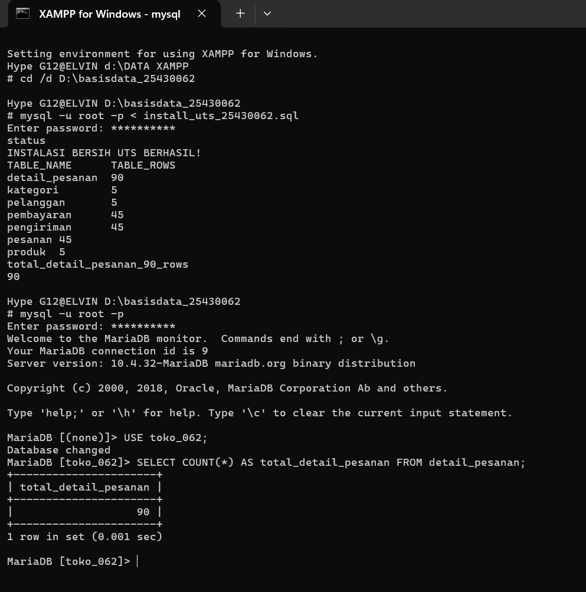

# Laporan Praktikum Basis Data - Pertemuan 8 (UTS Proyek Tahap 1)

**Nama:** Elvin Purna Hidayat       
**NIM:** 25430062   
**Kelas:** C     
**Mata Kuliah:** Basis Data       
**Pertemuan:** 8 (UTS)    

---

## 1. Tujuan dan Cakupan
Mengintegrasikan seluruh milestone Pertemuan 1–7 menjadi satu sistem basis data proyek `toko_062` yang utuh, dapat dipasang ulang secara otomatis dari skrip DDL/DML, serta dapat dipertanggungjawabkan melalui sesi verifikasi (demo, modifikasi langsung, dan viva).

## 2. Pelaksanaan Pemasangan Bersih (Clean Install)
Eksekusi skrip `install_uts_25430062.sql` pada basis data kosong `toko_062` berhasil membangun 7 tabel relasional dan mengisikan data sampel transaksi utama sebanyak 90 baris.

### Bukti Tangkapan Layar Pemasangan Bersih


## 3. Catatan Modifikasi Langsung (Bank Modifikasi UTS)
Pada sesi uji coba modifikasi langsung oleh penguji:
- **Permintaan Modifikasi:** Menambahkan kolom `status_garansi` pada tabel `produk` dengan nilai bawaan `'LOKAL_1_TAHUN'` dan menguji perubahan kueri.
- **Solusi SQL Modifikasi:**
  ```sql
  ALTER TABLE produk ADD COLUMN status_garansi VARCHAR(30) NOT NULL DEFAULT 'LOKAL_1_TAHUN';
  SELECT kode_produk, nama_produk, harga_produk, status_garansi FROM produk LIMIT 5;

## 4. Refleksi dan Evaluasi Keputusan Desain (Persiapan UAS)
Aturan Bisnis Belum Terjaga: Pengecekan agar qty_detail_pesanan tidak melebihi stok_produk tersedia belum dapat dijaga oleh constraint DDL biasa (dicatat sebagai utang desain yang akan diselesaikan dengan Trigger pada Modul 14).

Kueri Lintas-Tabel: Kueri KI-10 (total belanja invoice lengkap dengan nama pelanggan) memerlukan fitur JOIN dan GROUP BY yang dipelajari pada Pertemuan 9–12.

## 5. Kesimpulan
Proyek tahap 1 basis data Viinjay Store G62 (toko_062) lulus pengujian UTS. Seluruh struktur 3NF, constraint, dan 90 baris transaksi terintegrasi dengan baik dari skrip otomasinya.

## 6. Bukti Git
Tautan Repositori: https://github.com/elvinjoy1986-beep/Basisdata_25430062     
Commit Hash UTS Pertemuan 8: '61f6d5e'    

Checklist
[x] Berkas install_uts_25430062.sql Terbuat
[x] Berkas p08_uts_25430062.md Terbuat
[x] Instalasi Bersih Berhasil Dilakukan
[x] Tangkapan Layar p08_instalasi_uts.png Terlampir
