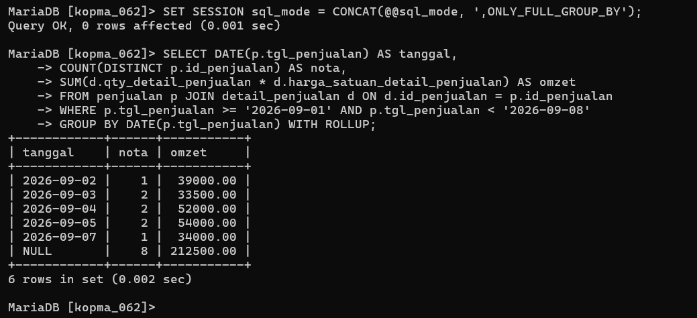
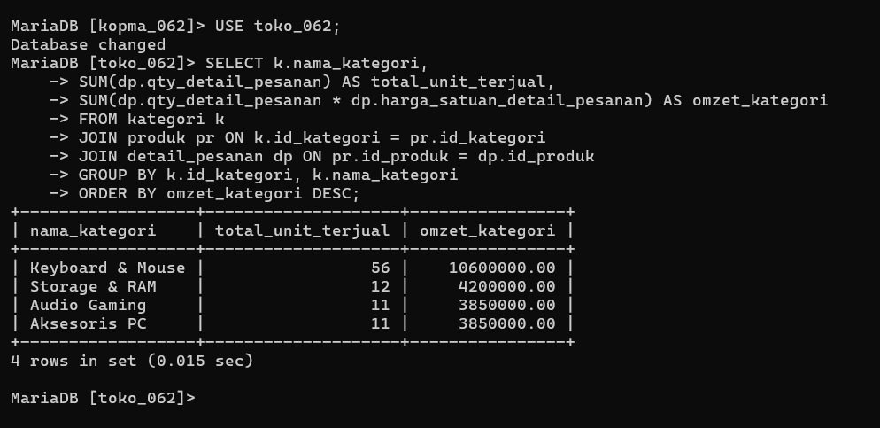

# Laporan Praktikum Basis Data - Modul 9

**Nama:** Elvin Purna Hidayat    
**NIM:** 25430062  
**Kelas:** C    
**Mata Kuliah:** Basis Data    

---

## 1. Tujuan Praktikum
1. Memakai fungsi agregat `COUNT`, `SUM`, `AVG`, `MIN`, dan `MAX` dengan benar serta memahami perilakunya terhadap nilai `NULL`[cite: 27].
2. Mengelompokkan data transaksi dengan klausa `GROUP BY` dan menyaring hasil kelompok menggunakan `HAVING`[cite: 27].
3. Menyusun laporan ringkasan hirarkis bertingkat menggunakan klausa `WITH ROLLUP`[cite: 27].
4. Mencegah kesalahan semantik agregasi dengan mengaktifkan mode ketat `ONLY_FULL_GROUP_BY`[cite: 27, 28].

## 2. Ringkasan Dasar Teori
Fungsi agregat menghitung satu nilai ringkasan dari sekumpulan baris [27]. Pengelompokan data dilakukan menggunakan `GROUP BY`, di mana klausa `WHERE` bertugas menyaring baris sebelum dikelompokkan, sedangkan `HAVING` menyaring kelompok setelah proses agregasi dilakukan [28]. Pengaktifan mode `ONLY_FULL_GROUP_BY` diwajibkan oleh ISO SQL agar semua kolom non-agregat pada klausa `SELECT` tercantum secara eksplisit di `GROUP BY` untuk menghindari ambiguitas data [28, 30].

## 3. Hasil Langkah Percobaan
* Mengaktifkan mode `ONLY_FULL_GROUP_BY` dan memuat data lanjutan pada basis data `kopma_062`[cite: 28, 29].
* Mengeksekusi laporan omzet harian (KI-01) dengan `WITH ROLLUP` dan omzet bulanan.
* Menyaring kinerja transaksi kasir menggunakan klausa `HAVING`[cite: 30].

### Bukti Tangkapan Layar Laporan Agregasi

## 4. Jawaban Titik Analisis
1. **Titik Analisis 1:** Menghapus `p.no_nota_penjualan` dari `GROUP BY` memicu `ERROR 1055` karena mode `ONLY_FULL_GROUP_BY` mewajibkan seluruh kolom non-agregat tercantum di `GROUP BY` demi menjamin kepastian hasil kueri[cite: 29, 30].
2. **Titik Analisis 2:** `COUNT(DISTINCT p.id_penjualan)` digunakan untuk menghitung jumlah transaksi unik[cite: 29]. Sebaliknya, `COUNT(*)` menghitung jumlah baris detail item barang akibat operasi `JOIN`[cite: 28, 30].
3. **Titik Analisis 3:** Syarat "anggota saja" wajib diletakkan pada `WHERE` (`id_anggota IS NOT NULL`) karena `WHERE` mengevaluasi dan menyaring baris sebelum pengelompokan `GROUP BY` dieksekusi[cite: 28, 30].

## 5. Hasil Latihan dan Modifikasi
1. Menghitung total belanja dengan diskon 5% bagi anggota aktif serta menampilkan kembalian transaksi yang melebihi Rp4.000 menggunakan klausa `HAVING`[cite: 30].
2. Laporan omzet per kategori barang per bulan dengan `WITH ROLLUP` menunjukkan baris `NULL` sebagai indikator penjelas subtotal bulanan dan *Grand Total* omzet keseluruhan[cite: 29, 30].

## 6. Tugas Mandiri: Milestone Proyek 9 (Viinjay Store G62)
* **Tema Proyek:** Toko Daring (`toko_062`)
* **Mode Ketat:** Seluruh kueri dieksekusi dengan `ONLY_FULL_GROUP_BY` aktif[cite: 30].
* **Fitur Agregasi:** Mengimplementasikan 5 laporan ringkasan yang mencakup `SUM`, `COUNT`, `HAVING`, `WITH ROLLUP`, serta menyelesaikan KI-PROJ-10 (total belanja invoice bersih) yang sebelumnya tertunda di Modul 7.

## 7. Kesimpulan
Fungsi agregat, `GROUP BY`, `HAVING`, dan `WITH ROLLUP` berhasil diimplementasikan untuk menyajikan laporan ringkasan eksekutif pada basis data Kopma dan Viinjay Store G62[cite: 27, 30].

## 8. Pernyataan Penggunaan AI
Penggunaan AI (Gemini) dimanfaatkan untuk membantu formulasi kueri agregasi kompleks dan penyusunan draf laporan Markdown.

## 9. Bukti Git
* **Tautan Repositori:** https://github.com/elvinjoy1986-beep/Basisdata_25430062
* **Commit Hash Pertemuan 9:** `a206532`

---

## Checklist
- [x] Berkas `p09_agregasi_kopma_25430062.sql` Terbuat
- [x] Berkas `p09_agregasi_25430062.sql` (5 Kueri Ringkasan Proyek) Terbuat[cite: 30, 31]
- [x] Mode `ONLY_FULL_GROUP_BY` Aktif[cite: 28, 30]
- [x] Tangkapan Layar `p09_omzet_kopma.png` & `p09_agregasi_proyek.png` Terlampir
