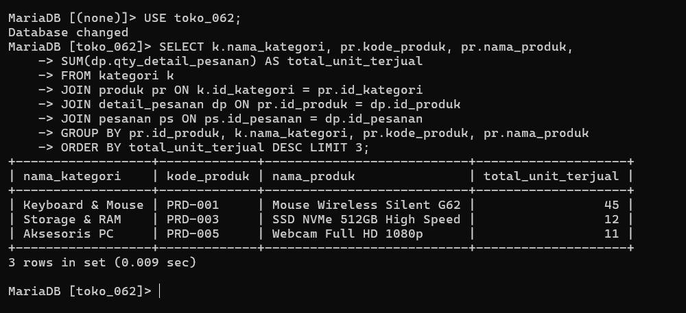
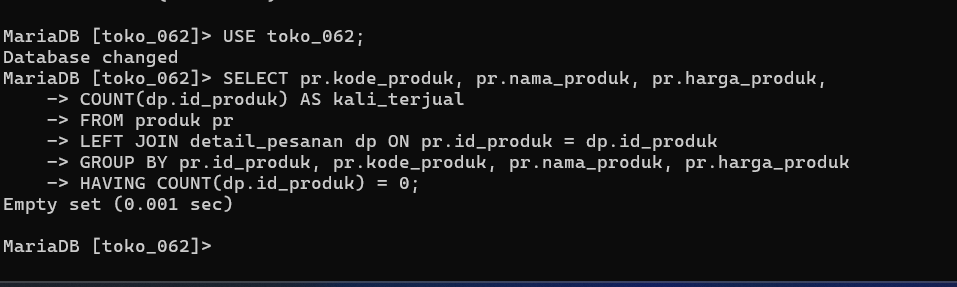

# Laporan Praktikum Basis Data - Modul 10

**Nama:** Elvin Purna Hidayat    
**NIM:** 25430062  
**Kelas:** C    
**Mata Kuliah:** Basis Data     

---

## 1. Tujuan Praktikum
1. Menggabungkan dua tabel atau lebih dengan `INNER JOIN` berdasarkan relasi kunci primer dan kunci tamu[cite: 23].
2. Memakai `LEFT JOIN` untuk menemukan record data yang tidak memiliki pasangan[cite: 23, 24].
3. Menggabungkan operasi `JOIN` dengan fungsi agregasi untuk menjawab Kebutuhan Informasi (KI) lintas tabel[cite: 23].
4. Mengenali dan mencegah hasil perkalian Kartesius yang tidak disengaja[cite: 23, 24].

## 2. Ringkasan Dasar Teori
Operasi `JOIN` digunakan untuk menyatukan kembali data yang dipisahkan oleh proses normalisasi [23, 24]. Setiap klausa `JOIN` yang valid wajib mengikuti garis relasi yang digambarkan pada ERD [23]. `INNER JOIN` hanya mengembalikan baris yang memiliki pasangan cocok di kedua tabel [24]. `LEFT JOIN` mengembalikan seluruh baris dari tabel kiri dan mengisi nilai `NULL` untuk baris tabel kanan yang tidak memiliki pasangan [24]. Hilangnya klausa `ON` menyebabkan terjadinya perkalian Kartesius di mana setiap baris tabel kiri dipasangkan dengan seluruh baris tabel kanan [24].

## 3. Hasil Langkah Percobaan
* Menjalankan kueri `INNER JOIN` 3 tabel untuk mendeteksi barang terlaris bulan Oktober 2026 (KI-02)[cite: 24, 25].
* Menjalankan kueri `JOIN` 3 tabel untuk mengetahui anggota dengan akumulasi belanja terbesar (KI-04)[cite: 25].
* Mengimplementasikan `LEFT JOIN` dan `HAVING COUNT = 0` untuk mencari barang yang belum pernah terjual[cite: 25].
* Membuktikan perkalian Kartesius tanpa klausa `ON` yang menghasilkan 10.950 baris[cite: 24, 26].

### Bukti Tangkapan Layar Kueri JOIN

## 4. Jawaban Titik Analisis
1. **Titik Analisis 1:** Roti Cokelat yang stoknya di bawah minimum tetapi paling terlaris harus segera dilaporkan ke petugas gudang untuk membuat pesanan restok (*purchase order*)[cite: 25].
2. **Titik Analisis 2:** `COUNT(*)` menghitung seluruh baris termasuk yang bernilai `NULL` dari hasil `LEFT JOIN`, sehingga Wafer Cokelat bernilai 1[cite: 25, 26]. Sebaliknya, `COUNT(d.id_barang)` mengabaikan nilai `NULL` sehingga secara akurat menghitung 0[cite: 25, 26].
3. **Titik Analisis 3:** Cara cepat mendeteksi perkalian Kartesius adalah mengeksekusi `SELECT COUNT(*)` tanpa agregasi dan mengecek apakah jumlahnya sama dengan perkalian total baris kedua tabel[cite: 24, 26].

## 5. Hasil Latihan dan Modifikasi
1. Menampilkan nota transaksi Oktober lengkap dengan nama kasir dan nama pembeli (menggunakan `IFNULL(a.nama_anggota, 'Umum')`)[cite: 26].
2. Membuktikan aturan AB-04 untuk Pulpen Gel 0.5 yang menunjukkan bahwa harga pada `detail_penjualan` mengunci harga saat transaksi terjadi dan tidak terpengaruh oleh perubahan harga di tabel `barang`[cite: 26].

## 6. Tugas Mandiri: Milestone Proyek 10 (Viinjay Store G62)
* **Tema Proyek:** Toko Daring (`toko_062`)
* **Jalur ERD:** Seluruh 5 kueri proyek telah dilengkapi dengan anotasi jalur ERD yang dilalui[cite: 26].
* **Variasi JOIN:** Mengimplementasikan `INNER JOIN` 3 & 4 tabel, `LEFT JOIN` produk/pelanggan tanpa transaksi, serta laporan status transaksi lengkap[cite: 24, 26].

## 7. Kesimpulan
Operasi `JOIN` berhasil digunakan untuk menyajikan laporan terintegrasi lintas tabel pada basis data Kopma dan Viinjay Store G62[cite: 23, 26].

## 8. Pernyataan Penggunaan AI
Penggunaan AI (Gemini) dimanfaatkan untuk membantu menyusun draf laporan Markdown dan formulasi kueri `JOIN` terstruktur.

## 9. Bukti Git
* **Tautan Repositori:** https://github.com/elvinjoy1986-beep/Basisdata_25430062
* **Commit Hash Pertemuan 10:** `31a8ba7`

---

## Checklist
- [x] Berkas `p10_join_kopma_25430062.sql` Terbuat[cite: 26, 27]
- [x] Berkas `p10_join_25430062.sql` (5 Kueri Lintas Tabel Berjalur ERD) Terbuat[cite: 26, 27]
- [x] Tangkapan Layar `p10_inner_join.png` & `p10_left_join.png` Terlampir[cite: 27]
