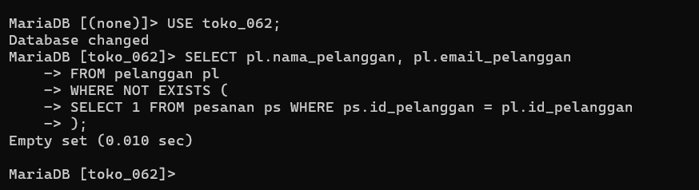
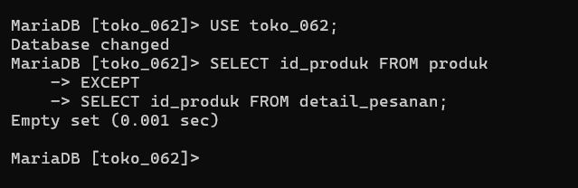

# Laporan Praktikum Basis Data - Modul 11

**Nama:** Elvin Purna Hidayat    
**NIM:** 25430062  
**Kelas:** C   
**Mata Kuliah:** Basis Data

---

## 1. Tujuan Praktikum
1. Menulis subquery skalar, subquery daftar dengan `IN`, dan subquery berkorelasi dengan `EXISTS` / `NOT EXISTS`[cite: 29].
2. Memakai tabel turunan (*derived table*) pada klausa `FROM`[cite: 29].
3. Menggabungkan hasil kueri dengan operasi himpunan `UNION`, `UNION ALL`, `INTERSECT`, dan `EXCEPT`[cite: 29].
4. Mengenali dan menangani jebakan `NOT IN` terhadap nilai `NULL`[cite: 29, 30].

## 2. Ringkasan Dasar Teori
Subquery adalah kueri yang disisipkan di dalam kueri lain [29]. Penggunaan `NOT IN` sangat rentan terhadap kegagalan diam-diam (*silent failure*) jika subquery mengembalikan nilai `NULL`, karena perbandingan dengan `NULL` menghasilkan nilai `UNKNOWN` [30]. Oleh karena itu, penggunaan `NOT EXISTS` lebih disarankan untuk membandingkan keberadaan baris data [30]. Operasi himpunan menyatukan dua atau lebih kueri yang memiliki struktur kolom yang setara [30].

## 3. Hasil Langkah Percobaan
* Mengeksekusi subquery skalar untuk mencari barang dengan harga di atas rata-rata[cite: 30].
* Membuktikan bahaya jebakan `NOT IN` pada tabel Kopma dan memperbaikinya menggunakan `NOT EXISTS`.
* Menghitung rerata belanja per nota dengan *derived table*[cite: 31].
* Menggabungkan dan membandingkan entitas data menggunakan `INTERSECT` dan `EXCEPT`[cite: 31].

### Bukti Tangkapan Layar Subquery & Operasi Himpunan

## 4. Jawaban Titik Analisis
1. **Titik Analisis 1:** `NOT IN` mengembalikan 0 baris pada Kopma karena terdapat nilai `id_anggota = NULL` (pembeli umum)[cite: 30, 31]. Solusinya adalah menyaring `WHERE id_anggota IS NOT NULL` atau menggunakan `NOT EXISTS` yang aman dari `NULL` secara bawaan[cite: 30, 31].
2. **Titik Analisis 2:** `AVG()` langsung pada tabel detail merata-ratakan nilai per baris item, bukan per transaksi[cite: 31]. Untuk mendapatkan rata-rata per nota, subtotal transaksi harus dihitung terlebih dahulu pada tabel turunan (*derived table*)[cite: 31].
3. **Titik Analisis 3:** Operasi `EXCEPT` dipilih saat hanya membutuhkan perbandingan himpunan entitas berbasis ID, sedangkan `LEFT JOIN` digunakan ketika ingin menampilkan kolom rinci lainnya dari tabel asal[cite: 31].

## 5. Hasil Latihan dan Modifikasi
1. Mengubah kueri `INTERSECT` menjadi versi `IN` dan `EXISTS` yang menghasilkan data identik[cite: 32].
2. Menggabungkan kontak anggota dan pemasok menggunakan `UNION ALL`[cite: 32].

## 6. Tugas Mandiri: Milestone Proyek 11 (Viinjay Store G62)
* **Tema Proyek:** Toko Daring (`toko_062`)
* **Analisis NOT IN:** Pada proyek Viinjay Store G62, kolom `id_pelanggan` pada tabel `pesanan` diset `NOT NULL`, sehingga `NOT IN` aman, namun penggunaan `NOT EXISTS` tetap diterapkan sebagai praktik terbaik[cite: 32].
* **Perbandingan Subquery vs JOIN:**
  * *Versi Subquery (`NOT EXISTS`):*
    `SELECT nama_pelanggan FROM pelanggan pl WHERE NOT EXISTS (SELECT 1 FROM pesanan ps WHERE ps.id_pelanggan = pl.id_pelanggan);`
  * *Versi JOIN (`LEFT JOIN`):*
    `SELECT pl.nama_pelanggan FROM pelanggan pl LEFT JOIN pesanan ps ON pl.id_pelanggan = ps.id_pelanggan WHERE ps.id_pesanan IS NULL;`

## 7. Kesimpulan
Subquery, *derived table*, dan operasi himpunan berhasil diimplementasikan untuk analisis data tingkat lanjut pada basis data `toko_062`[cite: 29, 32].

## 8. Pernyataan Penggunaan AI
Penggunaan AI (Gemini) dimanfaatkan untuk menyusun draf laporan Markdown dan formulasi kueri subquery analitis.

## 9. Bukti Git
* **Tautan Repositori:** https://github.com/elvinjoy1986-beep/Basisdata_25430062
* **Commit Hash Pertemuan 11:** `adbb25f`

---

## Checklist
- [x] Berkas `p11_subquery_kopma_25430062.sql` Terbuat
- [x] Berkas `p11_subquery_25430062.sql` Terbuat[cite: 32, 33]
- [x] Tangkapan Layar `p11_not_exists.png` & `p11_except.png` Terlampir
