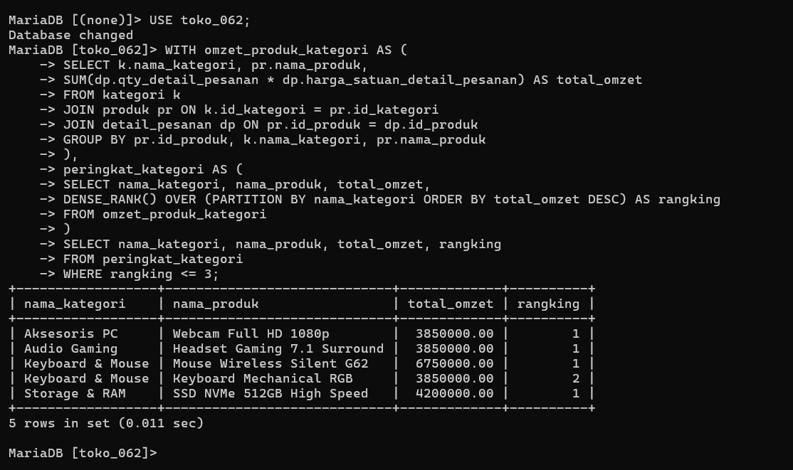
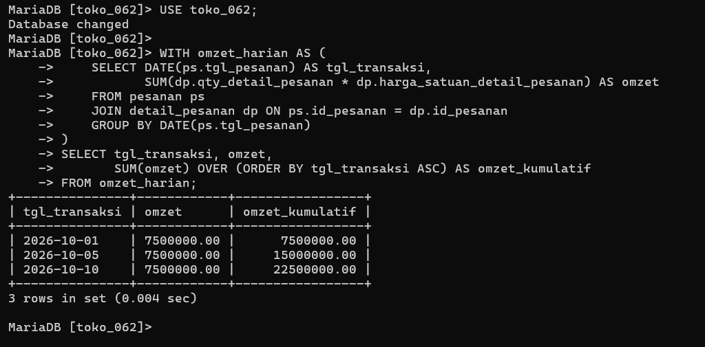

# Laporan Praktikum Basis Data - Modul 12

**Nama:** Elvin Purna Hidayat   
**NIM:** 25430062  
**Kelas:** C   
**Mata Kuliah:** Basis Data  

---

## 1. Tujuan Praktikum
1. Menyusun kueri bertahap yang mudah dibaca menggunakan Common Table Expression (CTE / `WITH`)[cite: 27].
2. Membangkitkan deret tanggal otomatis dengan CTE rekursif untuk mendeteksi tanggal tanpa transaksi[cite: 27].
3. Menghitung peringkat data menggunakan *window function* (`ROW_NUMBER`, `RANK`, dan `DENSE_RANK`)[cite: 27, 28].
4. Menghitung total berjalan (*cumulative total*) dan perubahan antarperiode dengan `SUM() OVER` dan `LAG`[cite: 27].

## 2. Ringkasan Dasar Teori
Common Table Expression (CTE) memberikan nama pada hasil kueri sementara sehingga struktur kueri kompleks dapat dibaca secara logis dari atas ke bawah [27]. Berbeda dengan `GROUP BY` yang memadatkan baris, *window function* melakukan kalkulasi pada sekumpulan baris ("window") tanpa mengurangi jumlah baris data [27, 28]. Klausa `PARTITION BY` membagi jendela data per kelompok, sedangkan `ORDER BY` menentukan urutan kueri di dalam jendela tersebut [27].

## 3. Hasil Langkah Percobaan
* Menghitung peringkat omzet barang per kategori menggunakan `RANK()` dan CTE[cite: 28].
* Membangkitkan kalender tanggal 1–14 Oktober 2026 dengan CTE rekursif untuk menemukan hari tanpa penjualan[cite: 28, 29].
* Menghitung akumulasi total berjalan omzet harian dan selisih pertumbuhan omzet menggunakan `LAG()`[cite: 29, 30].

### Bukti Tangkapan Layar Laporan CTE & Window Function

## 4. Jawaban Titik Analisis
1. **Titik Analisis 1:** Klausa `WHERE` tidak dapat menyaring alias *window function* di kueri yang sama karena `WHERE` dievaluasi sebelum *window function* dihitung[cite: 28, 30]. Solusinya adalah membungkus kueri pertama di dalam CTE kedua, lalu menyaring `WHERE peringkat = 1` di kueri luar[cite: 28].
2. **Titik Analisis 2:** Hari libur/tutup toko dapat disaring dengan `DAYOFWEEK(tgl_kalender)`. Kueri tanpa CTE rekursif tidak akan menampilkan tanggal tersebut karena data tanggal tanpa transaksi tidak tersimpan secara fisik di tabel basis data[cite: 29].
3. **Titik Analisis 3:** Nilai `LAG()` pada baris pertama bernilai `NULL` karena tidak ada baris pendahulu[cite: 29, 30]. Selisih dihitung berdasarkan baris transaksi terdahulu yang tercatat, bukan pasti H-1 kalender[cite: 29, 30].

## 5. Hasil Latihan dan Modifikasi
1. Memilih tepat satu nota belanja terbesar per anggota dengan `ROW_NUMBER() OVER (PARTITION BY id_anggota ORDER BY total_belanja DESC)`[cite: 30].
2. Menghitung persentase pangsa omzet kategori terhadap total bulanan menggunakan `SUM() OVER (PARTITION BY bulan)`[cite: 30].

## 6. Tugas Mandiri: Milestone Proyek 12 (Viinjay Store G62)
* **Tema Proyek:** Toko Daring (`toko_062`)
* **Rationale Pemilihan Window Function:**
  * `DENSE_RANK()` digunakan untuk peringkat produk terlaris agar jika terdapat nilai omzet yang sama/kembar, urutan peringkat berikutnya tidak melompat (misal: 1, 2, 2, 3)[cite: 28].
  * `ROW_NUMBER()` digunakan ketika ingin mengambil tepat 1 baris sampel unik per kelompok[cite: 28].

## 7. Kesimpulan
CTE dan *window function* berhasil diimplementasikan untuk menghasilkan analisis analitis mendalam seperti peringkat, akumulasi omzet, dan tren pertumbuhan harian pada Viinjay Store G62[cite: 27, 31].

## 8. Pernyataan Penggunaan AI
Penggunaan AI (Gemini) dimanfaatkan untuk membantu menyusun draf laporan Markdown dan formulasi kueri CTE analitis.

## 9. Bukti Git
* **Tautan Repositori:** https://github.com/elvinjoy1986-beep/Basisdata_25430062
* **Commit Hash Pertemuan 12:** `p12_hash`

---

## Checklist
- [x] Berkas `p12_cte_window_kopma_25430062.sql` Terbuat
- [x] Berkas `p12_cte_window_25430062.sql` Terbuat[cite: 30, 31]
- [x] Tangkapan Layar `p12_peringkat.png` & `p12_tren_omzet.png` Terlampir