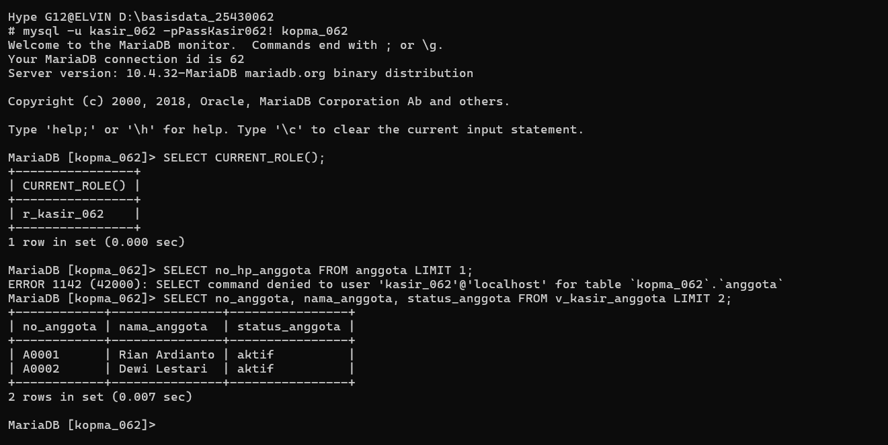
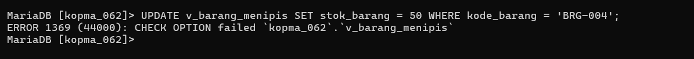

# Laporan Praktikum Basis Data - Modul 13

**Nama:** Elvin Purna Hidayat    
**NIM:** 25430062  
**Kelas:** C    
**Mata Kuliah:** Basis Data     

---

## 1. Tujuan Praktikum
1. Membuat *view* untuk menyederhanakan kueri laporan yang sering digunakan[cite: 30].
2. Merancang *view* per peran yang menyembunyikan kolom data pribadi sesuai prinsip UU PDP[cite: 30, 31].
3. Memberi hak akses melalui *role* ke *view*, bukan ke tabel dasar[cite: 30, 31].
4. Menjaga integritas perubahan data melalui *view* dengan klausa `WITH CHECK OPTION`[cite: 30].

## 2. Ringkasan Dasar Teori
*View* merupakan tabel virtual yang didefinisikan oleh kueri SQL dan tidak menyimpan data secara fisik [30]. Pembatasan akses kolom pribadi melalui *view* mendukung prinsip minimalisasi akses data pribadi UU PDP [31]. Penggunaan *role* mempermudah manajemen hak akses pengguna secara tersentralisasi [31]. Klausa `WITH CHECK OPTION` memastikan seluruh operasi `UPDATE` atau `INSERT` melalui *view* tetap memenuhi kondisi klausa `WHERE` pada definisi *view* tersebut [30, 32].

## 3. Matriks Peran vs View (Viinjay Store G62)

| Peran | View Resmi | Kolom Diberikan | Data Sensitif Disembunyikan |
| :--- | :--- | :--- | :--- |
| **Kasir** | `v_kasir_pelanggan` | `id_pelanggan`, `nama_pelanggan`, `email_pelanggan` | `no_hp_pelanggan`, `alamat_pelanggan` |
| **Gudang** | `v_gudang_stok_kritis` | `id_produk`, `kode_produk`, `nama_produk`, `stok_produk`, `harga_produk` | Kolom sensitif di luar persediaan |
| **Eksekutif** | `v_eksekutif_omzet_bulan` | `bulan`, `jumlah_invoice`, `omzet_kotor` | Rincian data transaksi individual |

## 4. Hasil Langkah Percobaan
* Membuat *view* per peran pada basis data Kopma (`v_kasir_anggota`, `v_barang_menipis`, `v_omzet_harian`)[cite: 32].
* Membuat *role* `r_kasir_062` dan akun `kasir_062` melalui pengguna `root`[cite: 32].
* Membuktikan penolakan akses langsung ke tabel dasar `anggota` (`ERROR 1142`) dan keberhasilan membaca *view* `v_kasir_anggota`.
* Membuktikan kegagalan penambahan stok Roti Cokelat yang melebihi batas akibat klausa `WITH CHECK OPTION` (`ERROR 1369`).

### Bukti Tangkapan Layar Akses View & Penolakan Tabel

## 5. Jawaban Titik Analisis
1. **Titik Analisis 1:** Jika akun DEFINER (`mhs_062`) tidak ada di server baru, eksekusi *view* akan gagal dengan `ERROR 1449` karena *view* berjalan di bawah konteks hak akses pembuatnya[cite: 31, 32].
2. **Titik Analisis 2:** `ERROR 1142` membuktikan bahwa pengguna tidak memiliki hak privilese `SELECT` pada tabel dasar[cite: 32, 33]. `ERROR 1054` membuktikan bahwa kolom data pribadi memang disembunyikan dari definisi *view*[cite: 32, 33].
3. **Titik Analisis 3:** `WITH CHECK OPTION` mencegah pengguna mengubah data hingga berada di luar cakupan *view*, yang dapat menyebabkan data hilang dari jendela pengawasan *view* tanpa adanya Peringatan[cite: 30, 33].

## 6. Hasil Latihan dan Modifikasi
1. Membuat *role* `r_ketua_062` yang hanya berhak membaca `v_omzet_harian` dan `v_barang_menipis`[cite: 33].
2. Menguji pencabutan hak *role* (`REVOKE`) dan penguncian akun (`ACCOUNT LOCK`) pada kasir yang berhenti bekerja[cite: 33].

## 7. Kesimpulan
Implementasi *view* per peran, *role*, dan `WITH CHECK OPTION` berhasil melindungi data sensitif pelanggan dan menjaga integritas basis data Viinjay Store G62[cite: 30, 31, 34].

## 8. Pernyataan Penggunaan AI
Penggunaan AI (Gemini) dimanfaatkan untuk membantu menyusun draf laporan Markdown dan formulasi DDL *view* per peran.

## 9. Bukti Git
* **Tautan Repositori:** https://github.com/elvinjoy1986-beep/Basisdata_25430062
* **Commit Hash Pertemuan 13:** `7ccc994`

---

## Checklist
- [x] Berkas `p13_view_kopma_25430062.sql` & `p13_role_kopma_25430062.sql` Terbuat
- [x] Berkas `p13_view_25430062.sql` & `p13_role_25430062.sql` Terbuat[cite: 33, 34]
- [x] Matriks Peran vs View Terlampir
- [x] Tangkapan Layar `p13_view_akses.png` & `p13_check_option.png` Terlampir
