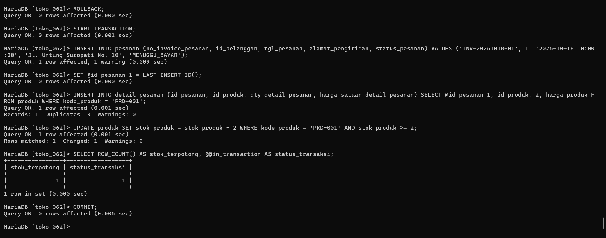
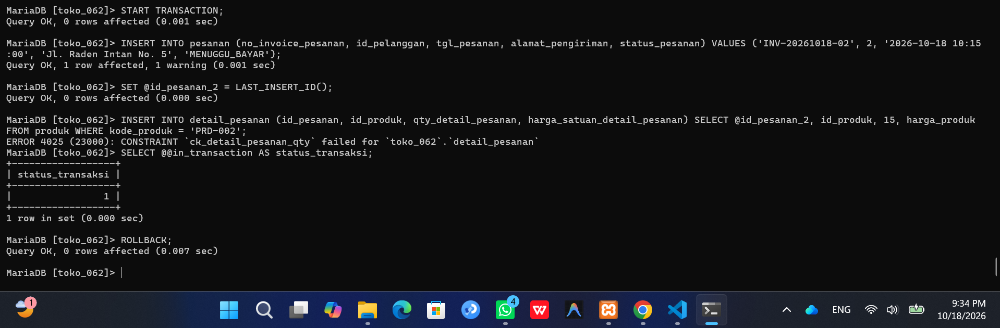

# Laporan Praktikum Basis Data - Modul 14

**Nama:** Elvin Purna Hidayat   
**NIM:** 25430062  
**Kelas:** C   
**Mata Kuliah:** Basis Data   

---

## 1. Tujuan Praktikum
1. Menjelaskan sifat ACID (*Atomicity, Consistency, Isolation, Durability*) dan pentingnya transaksi dalam menjaga konsistensi data[cite: 29].
2. Menulis transaksi menggunakan perintah `START TRANSACTION`, `COMMIT`, `ROLLBACK`, dan `SAVEPOINT`[cite: 29].
3. Memeriksa kondisi bisnis di dalam transaksi dan mengambil keputusan pembatalan bila kriteria tidak terpenuhi[cite: 29].
4. Mengenali perintah DDL yang memicu *commit* implisit[cite: 30].

## 2. Ringkasan Dasar Teori
Transaksi adalah sekumpulan operasi basis data yang dieksekusi sebagai satu kesatuan utuh [29]. Sifat ACID menjamin integritas data: *Atomicity* memastikan semua langkah berhasil atau tidak ada sama sekali; *Consistency* menjaga aturan bisnis tetap terpenuhi; *Isolation* mencegah transaksi yang berjalan bersamaan saling mengganggu; dan *Durability* memastikan perubahan yang di-*commit* tersimpan secara permanen [29].

## 3. Pemetaan Aturan Bisnis (AB-xx) dan Utang Desain

| Utang Desain / Aturan Bisnis | Mekanisme Penjagaan dalam Transaksi |
| :--- | :--- |
| **AB-01 (Nota Wajib Punya Minimal 1 Detail)** | Pembentukan header `pesanan` dan `detail_pesanan` dilakukan dalam satu blok `START TRANSACTION`. Jika rincian detail gagal, transaksi di-`ROLLBACK` sehingga header nota tidak tersimpan secara parsial[cite: 29, 30]. |
| **AB-02 (Penjualan Tidak Boleh Melebihi Stok)** | Pembaruan stok menggunakan ekspresi `WHERE stok_produk >= qty`. Hasil `ROW_COUNT()` diperiksa; jika bernilai `0`, transaksi di-`ROLLBACK`[cite: 31]. |
| **AB-03 (Batas Maksimal Pembelian P+2 = 11 Item)** | Jumlah akumulasi `qty` pada detail pesanan dihitung. Jika total `qty > 11`, transaksi secara eksplisit dibatalkan dengan `ROLLBACK`. |

## 4. Hasil Langkah Percobaan
* Menguji transaksi penjualan dengan kondisi stok tidak mencukupi yang berhasil dibatalkan menggunakan `ROLLBACK`[cite: 31].
* Membuktikan bahwa galat *constraint* tidak menutup transaksi secara otomatis (`@@in_transaction` tetap bernilai `1`)[cite: 31].
* Menguji fitur `SAVEPOINT` untuk membatalkan sebagian operasi pembaruan stok[cite: 32].

### Bukti Tangkapan Layar Skenario Transaksi

## 5. Jawaban Titik Analisis
1. **Titik Analisis 1:** Syarat `AND stok_barang >= 10` langsung pada `UPDATE` bersifat atomis dan memanfaatkan kunci baris (*row-level lock*) untuk mencegah kondisi pacu (*race condition*) antar-kasir[cite: 29, 31].
2. **Titik Analisis 2:** Jika pengguna melakukan `COMMIT` setelah galat, perintah sebelum galat tetap tersimpan[cite: 31]. Aplikasi kasir wajib menyertakan blok penanganan galat yang mengeksekusi `ROLLBACK` jika ada perintah yang gagal[cite: 31].
3. **Titik Analisis 3:** Logika *Atomicity* menjamin bahwa `INSERT` header nota dan `INSERT` detail nota dieksekusi bersama[cite: 29]. Kegagalan pada detail nota akan membatalkan penyisipan header nota secara keseluruhan[cite: 30, 32].

## 6. Hasil Latihan dan Modifikasi
1. Menyusun transaksi penerimaan barang dari pemasok yang memverifikasi `status_pembelian = 'dipesan'` sebelum menambah stok.
2. Menyusun transaksi dengan pembatasan jumlah item $P+2 = 11$.

## 7. Kesimpulan
Implementasi transaksi dengan `START TRANSACTION`, `COMMIT`, dan `ROLLBACK` berhasil melunasi seluruh utang desain serta menjaga integritas data pada Viinjay Store G62[cite: 29, 33].

## 8. Pernyataan Penggunaan AI
Penggunaan AI (Gemini) dimanfaatkan untuk membantu menyusun draf laporan Markdown dan skrip transaksi SQL.

## 9. Bukti Git
* **Tautan Repositori:** https://github.com/elvinjoy1986-beep/Basisdata_25430062
* **Commit Hash Pertemuan 14:** `p14_hash`

---

## Checklist
- [x] Berkas `p14_transaksi_kopma_25430062.sql` Terbuat
- [x] Berkas `p14_transaksi_25430062.sql` Terbuat
- [x] Tangkapan Layar `p14_commit.png` & `p14_rollback.png` Terlampir[cite: 33]