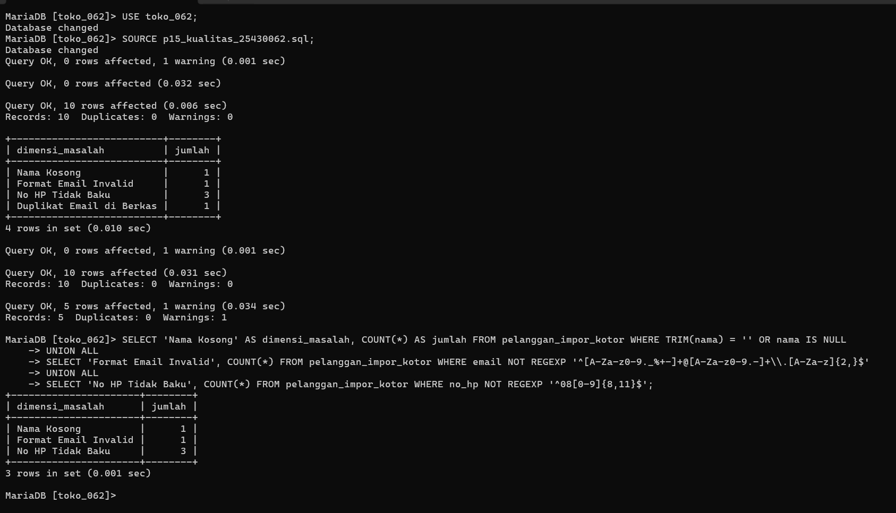
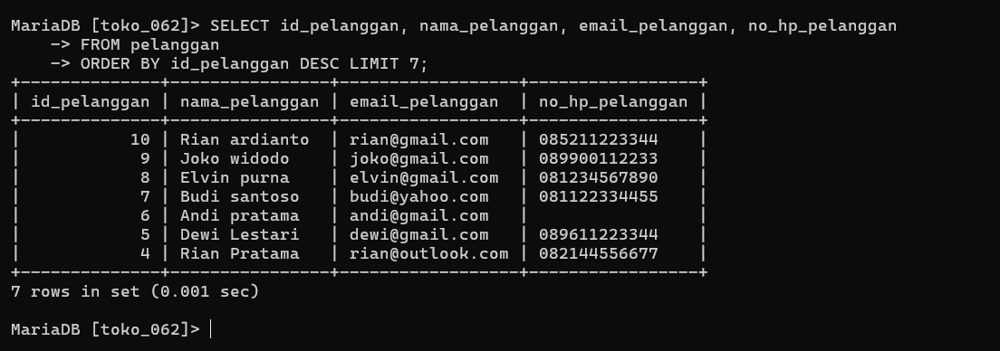

# Laporan Praktikum Basis Data - Modul 15

**Nama:** Elvin Purna Hidayat     
**NIM:** 25430062  
**Kelas:** C      
**Mata Kuliah:** Basis Data    

---

## 1. Tujuan Praktikum
1. Menetapkan dimensi dan parameter kualitas data sesuai kebutuhan organisasi Kopma dan Viinjay Store G62[cite: 37].
2. Mengukur tingkat masalah kualitas data menggunakan kueri profil[cite: 37, 38].
3. Membersihkan data pada tabel penampung (*staging table*) dengan fungsi *string*, `REGEXP`, dan validasi tanggal[cite: 37, 39, 40].
4. Memindahkan data bersih ke tabel utama tanpa duplikat dan mengukur ulang kualitasnya[cite: 37, 40, 41].

## 2. Ringkasan Dasar Teori
Siklus pengelolaan kualitas data meliputi penyusunan kerangka kerja, penilaian awal, penentuan prioritas, dan operasi koreksi data [38]. Penggunaan tabel penampung (*staging table*) sangat penting agar data mentah tidak langsung masuk ke tabel utama [38]. Validasi tanggal harus diperiksa rentang kalendernya sebelum dikonversi agar tidak menghasilkan tanggal rekaan/invalid [39, 41].

## 3. Hasil Langkah Percobaan
* Mengeksekusi kueri profil awal untuk mendeteksi HP tidak baku, NIM ganda, dan nama kosong pada `anggota_impor`.
* Membersihkan format nama, prodi, nomor HP, dan tanggal pada tabel `anggota_bersih`[cite: 39, 40].
* Memindahkan 6 anggota baru yang valid (`A-0469` s.d. `A-0474`) ke tabel utama `anggota`[cite: 40].

### Bukti Tangkapan Layar Profil Kualitas Data

## 4. Jawaban Titik Analisis
1. **Titik Analisis 1:** `STR_TO_DATE()` dapat mengonversi '31/09/2026' menjadi tanggal tidak valid tanpa `NULL` pada mode non-strict[cite: 39]. Pelajarannya adalah validasi rentang tanggal wajib dilakukan sebelum fungsi konversi dipanggil[cite: 39, 41].
2. **Titik Analisis 2:** Pembersihan nama berdampak rendah karena tidak merusak kunci relasi[cite: 40]. Pembersihan nama secara agresif berisiko merusak penulisan nama bermarga/bergelar[cite: 40].
3. **Titik Analisis 3:** Menerima anggota dengan nomor HP kosong adalah benar sesuai aturan kelengkapan dan prinsip minimalisasi data pribadi UU PDP.

## 5. Hasil Latihan dan Modifikasi
1. Menyusun kueri kapitalisasi setiap kata menggunakan CTE rekursif[cite: 41].
2. Menambahkan validasi akurasi antara digit tahun NIM dengan tahun pendaftaran[cite: 41].

## 6. Tugas Mandiri: Milestone Proyek 15 (Viinjay Store G62)
* **Tema Proyek:** Toko Daring (`toko_062`)[cite: 38]
* **Hasil Pembersihan:** Memproses 10 baris data kotor pada `pelanggan_impor_kotor` dan memindahkan 7 baris data bersih ke tabel `pelanggan`.

## 7. Kesimpulan
Implementasi tabel penampung, validasi `REGEXP`, dan de-duplikasi `ROW_NUMBER()` berhasil menjamin 100% kualitas data yang masuk ke basis data Viinjay Store G62[cite: 37, 40, 41].

## 8. Pernyataan Penggunaan AI
Penggunaan AI (Gemini) dimanfaatkan untuk menyusun draf laporan Markdown dan formulasi kueri pembersihan data `REGEXP`.

## 9. Bukti Git
* **Tautan Repositori:** https://github.com/elvinjoy1986-beep/Basisdata_25430062
* **Commit Hash Pertemuan 15:** `461657b`

---

## Checklist
- [x] Berkas `p15_kualitas_kopma_25430062.sql` & `p15_kualitas_25430062.sql` Terbuat[cite: 41, 42]
- [x] Berkas `Laporan/p15_audit_kualitas_25430062.md` Terbuat[cite: 41, 42]
- [x] Tangkapan Layar `p15_profil_awal.png` & `p15_data_bersih.png` Terlampir
