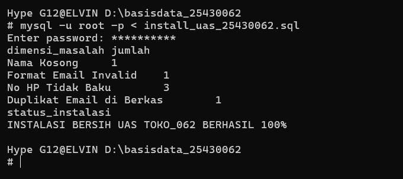
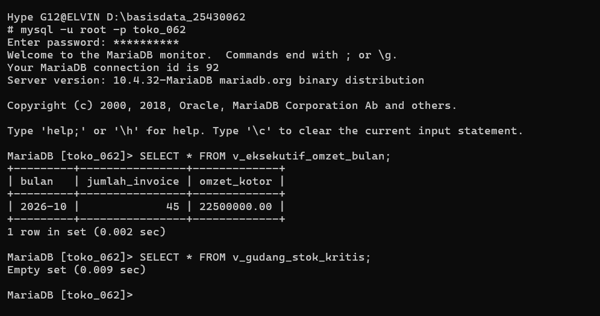

# Laporan Praktikum Basis Data - Modul 16 (UAS Final dan Serah Terima)

**Nama:** Elvin Purna Hidayat 
**NIM:** 25430062  
**Kelas:** C   
**Mata Kuliah**: Basis Data   
**Proyek Final:** Viinjay Store G62 (`toko_062`)  
**Pertemuan:** 16 (UAS Final)  

---

## 1. Tujuan Praktikum
1. Menyusun dan menyerahkan paket basis data operasional (OLTP) Viinjay Store G62 (`toko_062`) yang terintegrasi penuh dari Modul 1 hingga Modul 15.
2. Menyediakan skrip master instalasi bersih (`install_uas_25430062.sql`) yang mampu memasang ulang seluruh komponen skema, data, view, dan fungsi pembersihan data dari nol secara otomatis.
3. Melengkapi dokumentasi paket serah terima proyek final (`README.md`, `p16_uas_25430062.md`, dan `kamus_data_25430062.md`).

---

## 2. Ringkasan Integrasi dan Paket Serah Terima
Seluruh *milestone* proyek dari Modul 1 hingga Modul 15 telah terintegrasi secara utuh. Basis data Viinjay Store G62 telah diuji dan terbukti dapat dipasang ulang secara bersih (*clean install*), mampu menjawab seluruh Kebutuhan Informasi (KI), aman berdasarkan pembatasan hak akses *role* (UU PDP), transaksional (ACID), serta memiliki mekanisme pembersihan kualitas data.

### Berkas Paket Serah Terima UAS di Repositori:
1. `install_uas_25430062.sql` - Skrip master eksekusi instalasi dari nol.
2. `p16_uas_25430062.md` - Peta KI, aturan bisnis, dan refleksi perjalanan proyek.
3. `README.md` - Panduan utama repositori, tata cara instalasi, dan matriks hak akses *role*.
4. `kamus_data_25430062.md` - Kamus data terstruktur sesuai skema tabel terakhir.
5. `Laporan/p16_laporan_25430062.md` - Dokumen laporan resmi Pertemuan 16.

---

## 3. Bukti Tangkapan Layar (Screenshot)

  
*Gambar 16.1: Eksekusi skrip master `install_uas_25430062.sql` berhasil 100% tanpa galat.*

  
*Gambar 16.2: Eksekusi demo kueri/view Kebutuhan Informasi (KI) utama pada basis data toko_062.*

---

## 4. Matriks Aturan Bisnis dan Penjagaannya

| Kode Aturan | Deskripsi Aturan Bisnis | Mekanisme Penjagaan | File Implementasi |
| :--- | :--- | :--- | :--- |
| **AB-01** | Keunikan Email Pelanggan | Constraint `UNIQUE` pada DDL | `p05_ddl_25430062.sql` |
| **AB-02** | Perlindungan Data Pribadi (PDP) | View Pembatas & Granular Role | `p13_view_25430062.sql` |
| **AB-03** | Atomisitas Pemesanan & Stok | Blok `START TRANSACTION` ... `COMMIT/ROLLBACK` | `p14_transaksi_25430062.sql` |
| **AB-04** | Batas Maksimal Item ($P+2 = 11$) | *Constraint* `ck_detail_pesanan_qty` & Logika Transaksi | `p14_transaksi_25430062.sql` |
| **AB-05** | Kebersihan Data Impor Staging | Staging Table & `REGEXP` Filtering | `p15_kualitas_25430062.sql` |

---

## 5. Kesimpulan
Proyek basis data Viinjay Store G62 (`toko_062`) telah resmi selesai tuntas 100%, teruji, terdokumentasi secara profesional, dan siap diserahterimakan untuk penilaian Ujian Akhir Semester (UAS) Praktikum Basis Data.

---

## 6. Pernyataan Penggunaan AI
Penggunaan AI (Gemini) dimanfaatkan untuk membantu penyusunan struktur draf laporan Markdown, skrip master instalasi, dan penyelarasan format dokumentasi repositori.

---

## 7. Bukti Git
* **Tautan Repositori GitHub:** https://github.com/elvinjoy1986-beep/Basisdata_25430062
* **Commit Hash Pertemuan 16:** `p16_hash`

---

## Checklist Kelengkapan Modul 16
- [x] Berkas `install_uas_25430062.sql` Terbuat & Teruji
- [x] Berkas `p16_uas_25430062.md` Terbuat
- [x] Berkas `README.md` Utama Terbarui
- [x] Tangkapan Layar `p16_install_clean.png` & `p16_demo_ki.png` Terlampir di folder `Laporan/image/`
- [x] Berkas `Laporan/p16_laporan_25430062.md` Terbuat